# PSOC&trade; 4100S Plus: CAN bootloader

This example demonstrates CAN Bootloader using the DFU middleware library.
The device firmware update (DFU) occurs over the CAN2.0 interfaces. This includes downloading an application from a host device (PC/MCU) and installing it on the device flash.

This document details the following:

1. A high-level overview of the DFU process described in the [Design and implementation](#design-and-implementation) section
2. An example to explain the installation of CAN Bootloader firmware inside the flash of the target device and upload an application code via the CAN interface

This example bundles two applications:

- **Bootloader app:** Implements a DFU middleware library based-CAN bootloader application run by the CPU. The bootloader handles the image download, verification, erase, and upgrade processes. When the image is valid, the bootloader lets the CPU boot the application

- **Blinky app:** A tiny CPU-run application that continuously blinks an LED at a 5 Hz rate. This application transfers control to the bootloader when you press the user button. Here, the application project is a simple Blinky project, but you can change it according to your requirements

[View this README on GitHub.](https://github.com/Infineon/mtb-example-psoc4-can-bootloader)

[Provide feedback on this code example.](https://yourvoice.infineon.com/jfe/form/SV_1NTns53sK2yiljn?Q_EED=eyJVbmlxdWUgRG9jIElkIjoiQ0UyNDI3OTMiLCJTcGVjIE51bWJlciI6IjAwMi00Mjc5MyIsIkRvYyBUaXRsZSI6IlBTT0MmdHJhZGU7IDQxMDBTIFBsdXM6IENBTiBib290bG9hZGVyIiwicmlkIjoic2lkZGhlc2gucmF1dEBpbmZpbmVvbi5jb20iLCJEb2MgdmVyc2lvbiI6IjEuMC4wIiwiRG9jIExhbmd1YWdlIjoiRW5nbGlzaCIsIkRvYyBEaXZpc2lvbiI6Ik1DRCIsIkRvYyBCVSI6IkFVVE8iLCJEb2MgRmFtaWx5IjoiQVVUTyBQU09DIn0=)


## Requirements

- [ModusToolbox&trade;](https://www.infineon.com/modustoolbox) v3.7 or later (tested with v3.7)
- Board support package (BSP) minimum required version: 3.3.0
- Programming language: C
- Associated parts: [PSOC&trade; 4100S Plus](https://www.infineon.com/products/microcontroller/32-bit-psoc-arm-cortex/psoc-4-mcu/4100/psoc-4100s-plus)


## Supported toolchains (make variable 'TOOLCHAIN')

- GNU Arm&reg; Embedded Compiler v14.2.1 (`GCC_ARM`) – Default value of `TOOLCHAIN`
- Arm&reg; Compiler v6.24 (`ARM`)
- IAR C/C++ Compiler v9.70.1 (`IAR`)


## Supported kits (make variable 'TARGET')

- [PSOC&trade; 4100S Plus Prototyping Kit](https://www.infineon.com/CY8CKIT-149) (`CY8CKIT-149`)


## Hardware setup

- This example uses the board's default configuration for `CY8CKIT-149`. See the kit user guide and schematic to ensure that the board is configured correctly

- This code example requires one kits listed in the [Supported kits](#supported-kits-make-variable-target) section and PCAN-USB Pro

- In addition, kit from [Supported kits](#supported-kits-make-variable-target) requires a CY8CKIT-026 (CAN and LIN Shield) kit, which acts as the physical layer for the node

   > **Note**: Here, pin 1 and 2 of J20 of CY8CKIT-026 were shorted using the jumper. See [CY8CKIT-026 CAN and LIN Shield Kit Guide](https://www.infineon.com/cms/en/product/evaluation-boards/cy8ckit-026/#!?fileId=8ac78c8c7d0d8da4017d0efb313a110d) **3.6.4 Power Selection Jumper (J20)** for more details

**Figure 1. CAN connections**

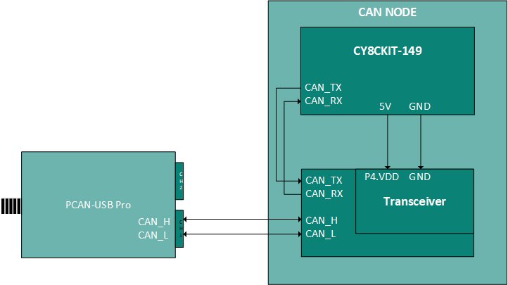

- Use jumper wires to establish a connection between CAN node and PCAN-USB Pro; see **Figure 1**

    1. Connect CAN_RX(J1[10]) pin, CAN_TX(J1[9])pin and CAN_EN(J1[11]) of the development kits to the respective CY8CKIT-026's CAN_RX, CAN_TX, and CAN_EN pins

    2. Connect CAN2_L (J23[1]) pin of node-1 in CY8CKIT-026 and CAN_L[CAN CH1_2/CAN CH2_2] of PCAN-USB Pro using jumper wires

    3. Connect CAN2_H (J23[2]) pin of node-1 in CY8CKIT-026 and CAN_H[CAN CH1_7/CAN CH2_7] of PCAN-USB Pro using jumper wires

    4. In CY8CKIT-026 kits, connect J1[7] to 5 V to power the CAN2 transceiver

- Pin assignments for the node-1 for supported kits are shown in the **Table 1**

**Table 1. Pin connections between the supported development kit and CY8CKIT-026 kit for each node**

Kit | CAN_EN | CAN_RX | CAN_TX | Ground | Power to CAN2 transceiver
---|---|---|---|--|---- 
CY8CKIT- 149 | 6[0] | 6[1] | 6[2] | GND | J1[30] (V5.0) 
CY8CKIT-026 | J9[1] | J9[3] | J9[2] | GND | J1[7] (P4.VDD)

   **Note:** To Operate this code example on CY8CKIT-149 Kit, remove 0 ohm resistor: R29, R30, and R31

<br>

## Software setup

See the [ModusToolbox&trade; tools package installation guide](https://www.infineon.com/ModusToolboxInstallguide) for information about installing and configuring the tools package.


This example requires no additional software or tools.


## Using the code example

### Create the project

The ModusToolbox&trade; tools package provides the Project Creator as both a GUI tool and a command line tool.

<details><summary><b>Use Project Creator GUI</b></summary>

1. Open the Project Creator GUI tool

   There are several ways to do this, including launching it from the dashboard or from inside the Eclipse IDE. For more details, see the [Project Creator user guide](https://www.infineon.com/ModusToolboxProjectCreator) (locally available at *{ModusToolbox&trade; install directory}/tools_{version}/project-creator/docs/project-creator.pdf*)

2. On the **Choose Board Support Package (BSP)** page, select a kit supported by this code example. See [Supported kits](#supported-kits-make-variable-target)

   > **Note:** To use this code example for a kit not listed here, you may need to update the source files. If the kit does not have the required resources, the application may not work

3. On the **Select Application** page:

   a. Select the **Applications(s) Root Path** and the **Target IDE**

      > **Note:** Depending on how you open the Project Creator tool, these fields may be pre-selected for you

   b. Select this code example from the list by enabling its check box

      > **Note:** You can narrow the list of displayed examples by typing in the filter box

   c. (Optional) Change the suggested **New Application Name** and **New BSP Name**

   d. Click **Create** to complete the application creation process

</details>


<details><summary><b>Use Project Creator CLI</b></summary>

The 'project-creator-cli' tool can be used to create applications from a CLI terminal or from within batch files or shell scripts. This tool is available in the *{ModusToolbox&trade; install directory}/tools_{version}/project-creator/* directory.

Use a CLI terminal to invoke the 'project-creator-cli' tool. On Windows, use the command-line 'modus-shell' program provided in the ModusToolbox&trade; installation instead of a standard Windows command-line application. This shell provides access to all ModusToolbox&trade; tools. You can access it by typing "modus-shell" in the search box in the Windows menu. In Linux and macOS, you can use any terminal application.


The following example clones the "[mtb-example-psoc4-dfu-basic](https://github.com/Infineon/mtb-example-psoc4-dfu-basic)" application with the desired name "MyCANBOOTLOADER" configured for the *CY8CKIT-149 BSP into the specified working directory, *C:/mtb_projects*:

   ```
   project-creator-cli --board-id CY8CKIT-149 --app-id mtb-example-psoc4-can-bootloader --user-app-name MyCANBOOTLOADER --target-dir "C:/mtb_projects"
   ```

The 'project-creator-cli' tool has the following arguments:

Argument | Description | Required/optional
---------|-------------|-----------
`--board-id` | Defined in the <id> field of the [BSP](https://github.com/Infineon?q=bsp-manifest&type=&language=&sort=) manifest | Required
`--app-id`   | Defined in the <id> field of the [CE](https://github.com/Infineon?q=ce-manifest&type=&language=&sort=) manifest | Required
`--target-dir`| Specify the directory in which the application is to be created if you prefer not to use the default current working directory | Optional
`--user-app-name`| Specify the name of the application if you prefer to have a name other than the example's default name | Optional

<br>

> **Note:** The project-creator-cli tool uses the `git clone` and `make getlibs` commands to fetch the repository and import the required libraries. For details, see the "Project creator tools" section of the [ModusToolbox&trade; tools package user guide](https://www.infineon.com/ModusToolboxUserGuide) (locally available at {ModusToolbox&trade; install directory}/docs_{version}/mtb_user_guide.pdf).

</details>


### Open the project

After the project has been created, you can open it in your preferred development environment.


<details><summary><b>Eclipse IDE</b></summary>

If you opened the Project Creator tool from the included Eclipse IDE, the project will open in Eclipse automatically.

For more details, see the [Eclipse IDE for ModusToolbox&trade; user guide](https://www.infineon.com/MTBEclipseIDEUserGuide) (locally available at *{ModusToolbox&trade; install directory}/docs_{version}/mt_ide_user_guide.pdf*).

</details>


<details><summary><b>Visual Studio (VS) Code</b></summary>

Launch VS Code manually, and then open the generated *{project-name}.code-workspace* file located in the project directory.

For more details, see the [Visual Studio Code for ModusToolbox&trade; user guide](https://www.infineon.com/MTBVSCodeUserGuide) (locally available at *{ModusToolbox&trade; install directory}/docs_{version}/mt_vscode_user_guide.pdf*).

</details>


<details><summary><b>Arm&reg; Keil&reg; µVision&reg;</b></summary>

Double-click the generated *{project-name}.cprj* file to launch the Keil&reg; µVision&reg; IDE.

For more details, see the [Arm&reg; Keil&reg; µVision&reg; for ModusToolbox&trade; user guide](https://www.infineon.com/MTBuVisionUserGuide) (locally available at *{ModusToolbox&trade; install directory}/docs_{version}/mt_uvision_user_guide.pdf*).

</details>


<details><summary><b>IAR Embedded Workbench</b></summary>

Open IAR Embedded Workbench manually, and create a new project. Then select the generated *{project-name}.ipcf* file located in the project directory.

For more details, see the [IAR Embedded Workbench for ModusToolbox&trade; user guide](https://www.infineon.com/MTBIARUserGuide) (locally available at *{ModusToolbox&trade; install directory}/docs_{version}/mt_iar_user_guide.pdf*).

</details>


<details><summary><b>Command line</b></summary>

If you prefer to use the CLI, open the appropriate terminal, and navigate to the project directory. On Windows, use the command-line 'modus-shell' program; on Linux and macOS, you can use any terminal application. From there, you can run various `make` commands.

For more details, see the [ModusToolbox&trade; tools package user guide](https://www.infineon.com/ModusToolboxUserGuide) (locally available at *{ModusToolbox&trade; install directory}/docs_{version}/mtb_user_guide.pdf*).

</details>


## Operation

1. Connect the board to your PC using the provided USB cable through the KitProg3 USB connector

2. Select **mtb-example-psoc4-can-bootloader** and click on **Build Application**, as shown in **Figure 2**, to build a project to bundle the bootloader and the Blinky application together

   **Figure 2. Building the application**

   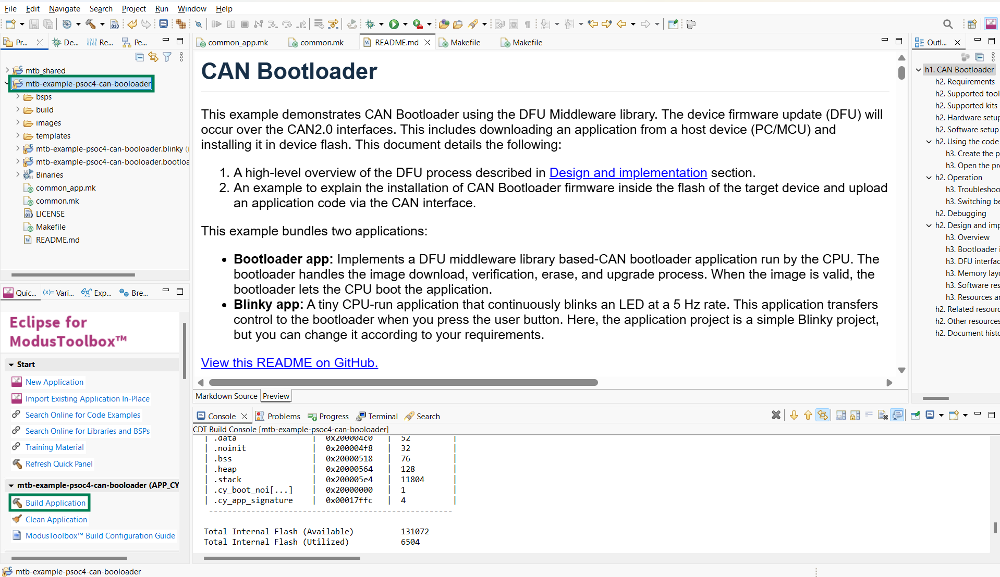

3. Flash the bootloader:

   <details><summary><b>Using Eclipse IDE</b></summary>

      1. Select the *bootloader* project (*mtb-example-psoc4-can-bootloader.bootloader*) in the Project Explorer.

      2. In the **Quick Panel**, scroll down to launches and click **mtb-example-psoc4-can-bootloader.bootloader Program (KitProg3_MiniProg4)**.

      **Figure 3. Flashing the bootloader**

      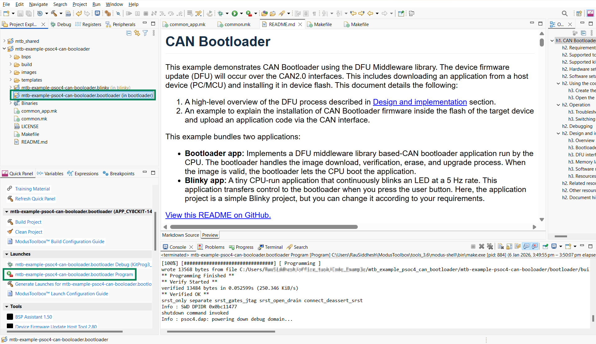

   </details>


   <details><summary><b>In other IDEs</b></summary>

   Follow the instructions in your preferred IDE

   </details>


   <details><summary><b>Using CLI</b></summary>

     From the terminal, execute the `make program` command to build and program the application using the default toolchain to the default target with default DFU transport. You can specify a target, toolchain and transport manually:
      ```
      make program TOOLCHAIN=<toolchain>
      ```

      Example:
      ```
      make program TOOLCHAIN=GCC_ARM
      ```
      > **Note:** The **TOOLCHAIN** variable is found in the **common.mk** makefile and is changed according to the user. However, the user has to provide the compiler path *CY_COMPILER_PATH=* in the makefiles of both the bootloader and the Blinky application
   </details>

4. After programming, the bootloader restarts, making the user LED blink at approximately 1 Hz

5. Perform the device firmware upgrade using the **DFU Host tool**:

   a. Open the [Device Firmware Upgrade Host tool](https://www.infineon.com/dgdlac/Infineon-ModusToolbox_Device_Firmware_Update_Host_Tool_%28Version_1.2%29-Software-v01_00-EN.pdf?fileId=8ac78c8c7d0d8da4017d0f8d42ba76bb) under the **Tools** section in the **Quick Panel**; plug in the kit

      **Figure 4. Device Firmware Upgrade Host tool**

      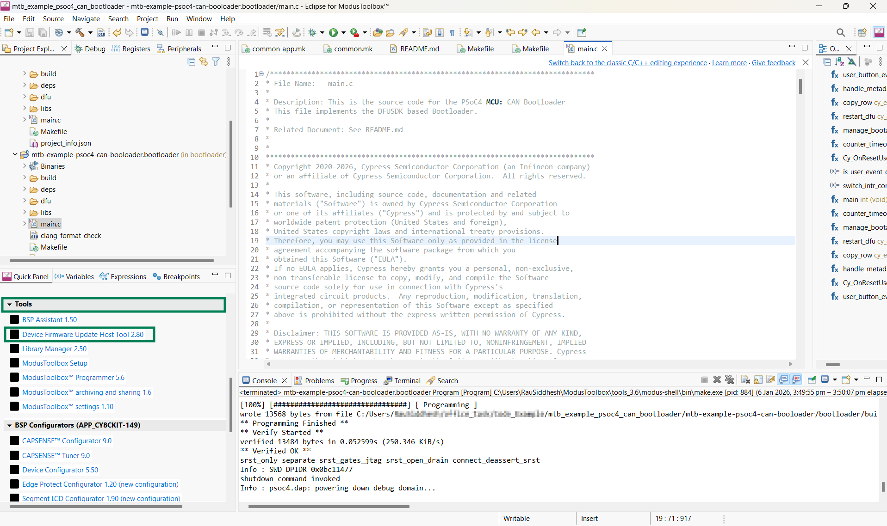

   b. Make a note of the path to the *blinky_crc.cyad2* file. You need it to configure the DFU Host tool. By default, it will be generated in the *mtb-example-psoc4-can-bootloader/blinky/build/APP_CY8CKIT-149/Debug* directory. Paste this path in the **File** field of the DFU Host tool

      **Figure 5. Locating the *\*.cyacd2* file**

      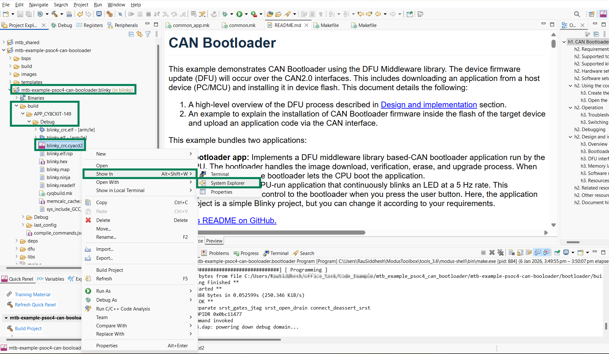

   c. Select the appropriate CAN configuration. The default parameters are:
   - CAN Bitrate (Kbits/sec) = 1000
   - Output Frame ID = 0x20
   - Input Frame ID = 0x10

   **Figure 6. Setting up the DFU Host tool**

   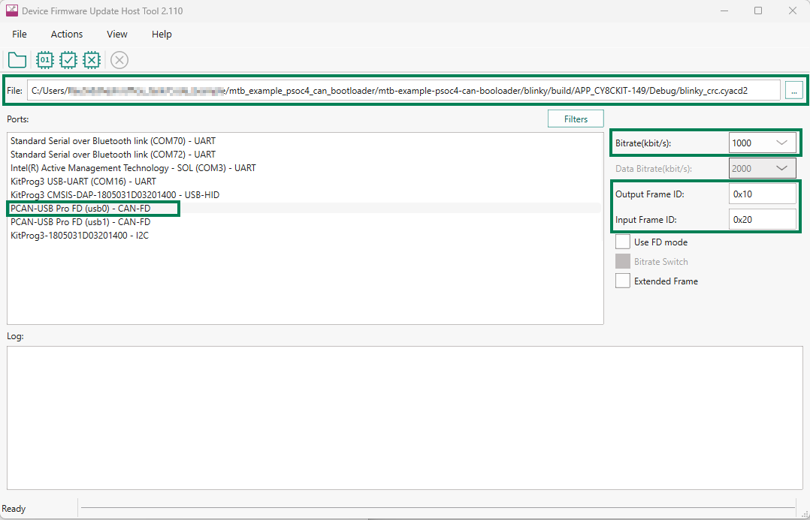

   d. Click **Program** and observe the image download progress status on the progress bar, and wait for the download to complete

      **Figure 7. Uploading the application firmware**

    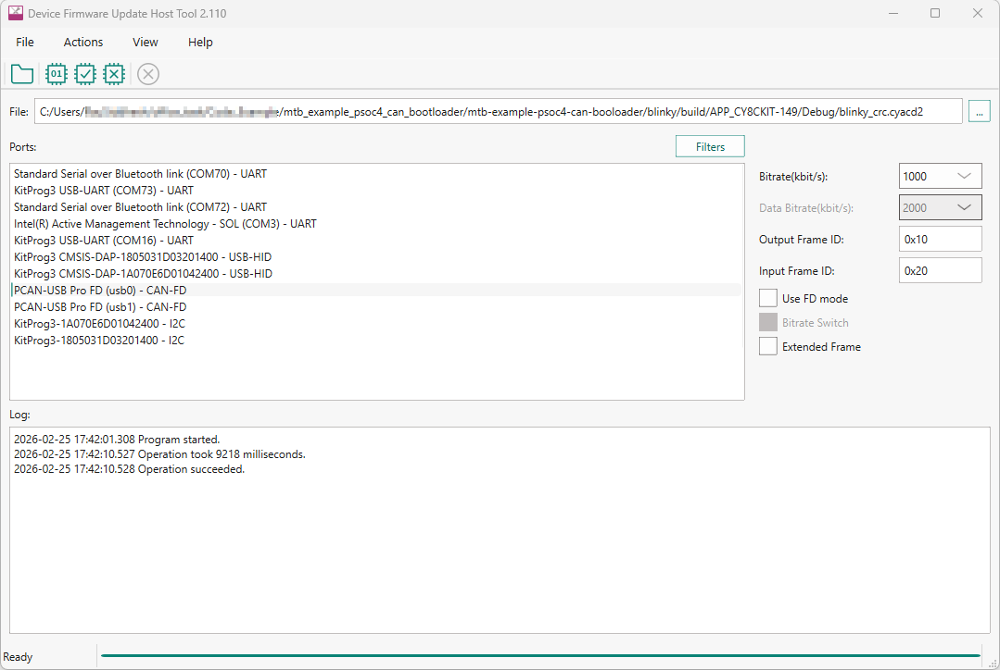

      > **Note:** See the [DFU Host tool](https://www.infineon.com/dgdlac/Infineon-ModusToolbox_Device_Firmware_Update_Host_Tool_%28Version_1.2%29-Software-v01_00-EN.pdf?fileId=8ac78c8c7d0d8da4017d0f8d42ba76bb) documentation for further details on selecting a port and configuring it for communication based on the transport enabled in the bootloader

   After you download the application firmware, the device starts to boot in the *blinky* project. Observe that the user LED blinks at 5 Hz


### Troubleshooting

   1. **Issue:  DFU Host Tool actions failing after updating the bootloader**

      The device might be previously programmed with a valid application and on reset, the bootloader boots to its previous application. To solve this issue, erase the entire device flash by running the `make erase` command in the terminal, as shown in **Figure 8**, and repeat from Step 3 of the previous section

      **Figure 8. Erasing the device chip**

      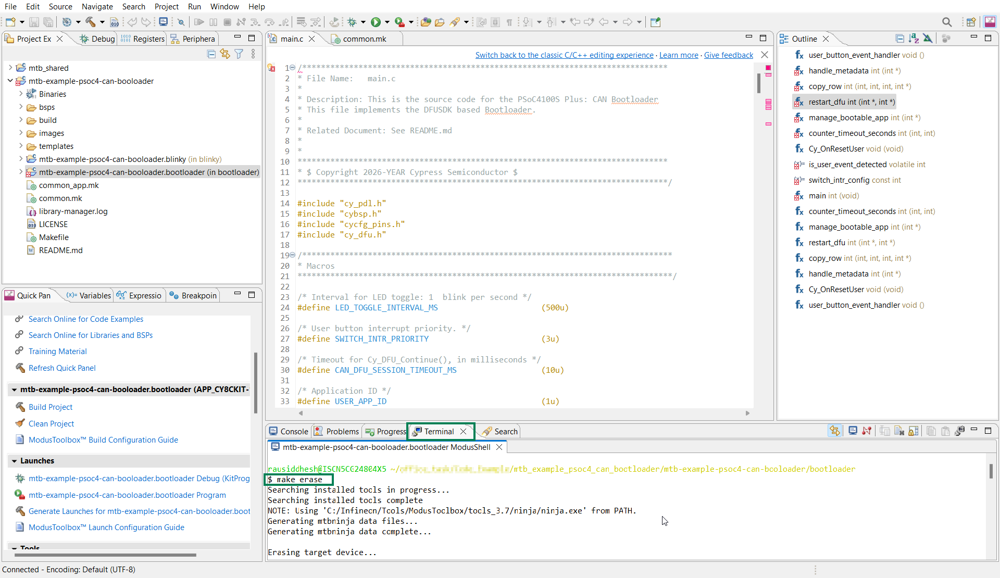


### Switching between the bootloader and application

Dynamic switching between the bootloader and the application is triggered by the user button events. Press the user button to switch to the bootloader while the application is running. Similarly, press the user button to switch to the application while the bootloader is running. Note that the bootloader accepts the switching request only if there is a valid application in the memory.

 The **Exit Bootloader** command is an integrated command given by the DFU MW. The command details and the packet structure is found in the host **command/response** protocol section of the application note [AN236282 - Device firmware update (DFU) middleware (MW) FOR ModusToolbox&trade;](https://www.infineon.com/AN236282).

Note that the bootloader accepts the switching request to jump to an application only if there is a valid application in the memory.


## Debugging

You can debug the example to step through the code.


<details><summary><b>In Eclipse IDE</b></summary>

Use the **\<Application Name> Debug (KitProg3_MiniProg4)** configuration in the **Quick Panel**. For details, see the "Program and debug" section in the [Eclipse IDE for ModusToolbox&trade; user guide](https://www.infineon.com/MTBEclipseIDEUserGuide).

</details>


<details><summary><b>In other IDEs</b></summary>

Follow the instructions in your preferred IDE.

</details>


## Design and implementation


### Overview

This example demonstrates the CAN bootloader operations based on the DFU middleware library

   **Figure 9. Bootloader flow diagram**

   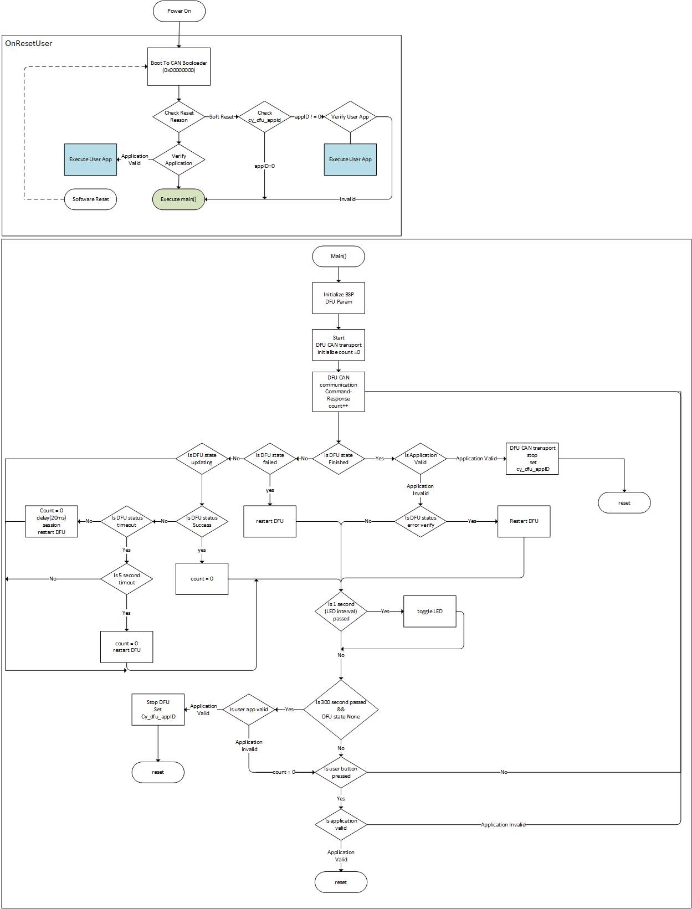


### Bootloader implementation

This *bootloader* project implements an immutable bootloader with support to upgrade the application firmware over CAN.

The [DFU Host Tool](https://www.infineon.com/dgdlac/Infineon-ModusToolbox_Device_Firmware_Update_Host_Tool_%28Version_1.2%29-Software-v01_00-EN.pdf?fileId=8ac78c8c7d0d8da4017d0f8d42ba76bb) (typically running on the host PC) sends the application (*\<APPNAME>.cyacd2*) to the device. The bootloader receives the application image in chunks and overwrites the existing application image (See **Figure 11**). If a DFU session is interrupted, the application firmware will not be in a usable state. However, the device can still run the bootloader and perform necessary actions to download and install the application in the subsequent DFU sessions.

**Figure 10. DFU design overview**

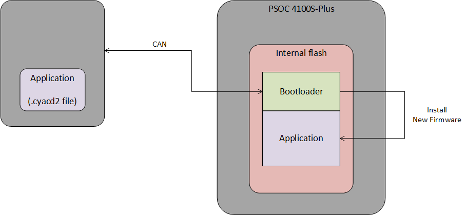


### DFU interfaces

The project supports CAN interfaces to communicate with the DFU host. The *config* directory in the *mtb-example-psoc4-dfu-basic/bsps/TARGET_APP_CY8CKIT-149/config* includes all the necessary configurations to select the supported interfaces. These configurations can also be edited or reconfigured using the **Device Configurator** under the **BSP Configurators** in the **Quick Panel**.

> **Note:** The Device Configurator is common for both the bootloader and the application; therefore, the resources are shared among them.

   **Figure 11. Device Configurator**

   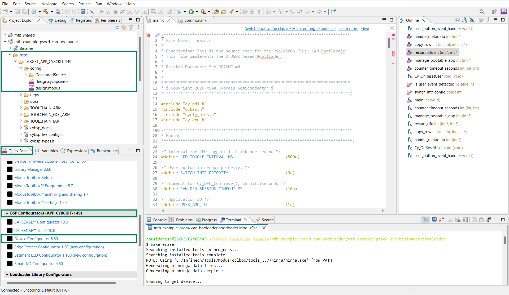

See the following table for the default configuration details. You can change the default configurations according to the use case. However, ensure that the configuration of the DFU Host tool matches with that of the project.

**DFU transport configurations**

  By default, both I2C and UART modes are enabled and configured for transport. For more details on transport resources, see [Resources and settings](#resources-and-settings).

**Default CAN configuration**

  Parameter | Default Setting | Description
   :--------------- | :------ | :-----
   CAN Bitrate | 1000 Kbits/sec  | CAN standard Baudrate
   Output Frame ID | 0x20 | Frame ID use to sent response frame
   Input Frame ID | 0x10 | Frame ID use to recieve command frame

   <br>

   **Figure 12. CAN configuration**

   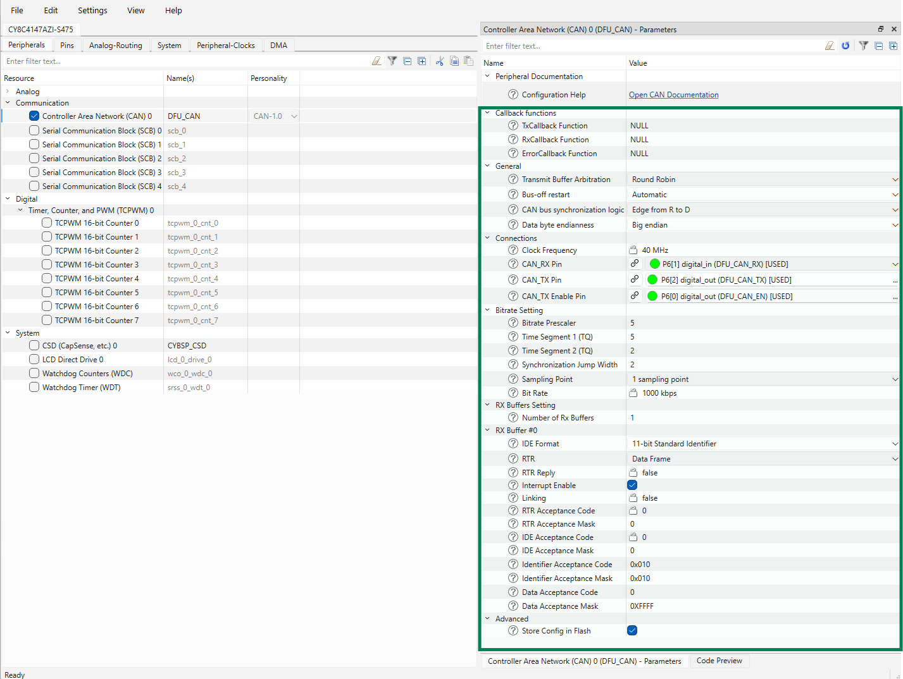


### Memory layout

The first 16 KB region of the flash is reserved for the bootloader followed by a 4 KB reserved region for future enhancements. Another 32 KB is allocated to the application firmware followed by the empty/reserved region. The size of this empty/reserved region depends on the size of the flash available on the selected target device. See the respective device datasheets for more details. The last 256 B region of the flash is reserved for bootloader metadata.

To change the memory layout or usage, update the respective target linker scripts. The files are found in the *bsps* folder.

For example: *mtb-example-psoc4-can-bootloader/bsps/TARGET_APP_CY8CKIT-149/COMPONENT_CM0p/TOOLCHAIN_GCC_ARM*.

**Figure 13. Linker scripts**

   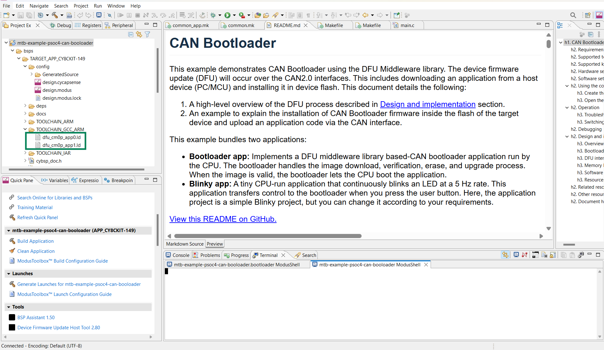

There are two linker scripts, one for each application in the corresponding toolchain directory. In the *TOOLCHAIN_GCC_ARM* directory, the *_dfu_cm0p_app0.ld_* linker script is for the bootloader and the *_dfu_cm0p_app1.ld_* linker script is for the Blinky application. The linker scripts can also be modified to define dedicated regions of the memory for each application.

The RAM is shared by the bootloader and Blinky application, with a common area used by both projects. The RAM regions must be aligned to the 1 KB boundary because they contain the interrupt vector table remapped at the start.

   **Figure 14. Flash layout of CY8CKIT-149**

   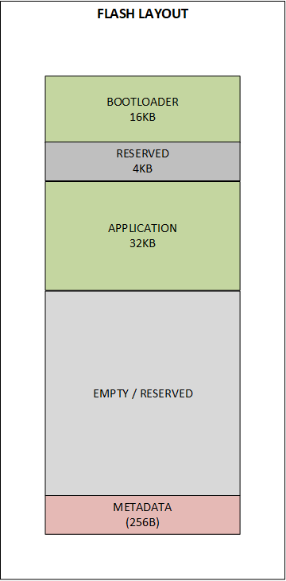

   <br>


### Software reset

The recommended method of transferring control from one application to another is through a device software reset. This enables each application to initialize device hardware blocks and signal routing from a known state. It is possible to freeze the state of I/O pins so they are maintained through a software reset. Defined portions of the SRAM are also maintained through a software reset. For more information, see the device-specific  reference manual.


### Resources and settings

**Table 1. Bootloader resources**

 Resource  |  Alias/object     |    Purpose
 :-------- | :-------------    | :------------
 CAN (PDL)     | DFU_CAN          | CAN driver to communicate with the DFU host
 GPIO (PDL)    | CYBSP_USER_LED         | User LED
 GPIO (PDL)    | CYBSP_USER_BTN         | User button

<br>

**Table 2. Application resources**

 Resource  |  Alias/object     |    Purpose
 :------- | :------------    | :------------
 GPIO (PDL)    | CYBSP_USER_LED         | User LED
 GPIO (PDL)    | CYBSP_USER_BTN         | User button

<br>


## Related resources

Resources  | Links
-----------|----------------------------------
Application notes  | [AN79953](https://www.infineon.com/AN79953) – Getting started with PSOC&trade; 4 <br>  [AN85951](https://www.infineon.com/AN85951) – PSOC&trade; 4 and PSOC&trade; 6 MCU CAPSENSE&trade; design guide
Code examples  | [Using ModusToolbox&trade;](https://github.com/Infineon/Code-Examples-for-ModusToolbox-Software) on GitHub
Device documentation | [PSOC&trade; 4 datasheets](https://www.infineon.com/cms/en/search.html?intc=searchkwr-return#!view=downloads&term=psoc%204&doc_group=Data%20Sheet) <br>[PSOC&trade; 4 technical reference manuals](https://www.infineon.com/cms/en/search.html#!term=psoc%204%20technical%20reference%20manual&view=all)
Development kits | Select your kits from the [Evaluation board finder](https://www.infineon.com/cms/en/design-support/finder-selection-tools/product-finder/evaluation-board)
Libraries on GitHub  | [mtb-pdl-cat2](https://github.com/Infineon/mtb-pdl-cat2) – PSOC&trade; 4 Peripheral Driver Library (PDL)
Middleware on GitHub  | [Device Firmware Update (DFU) Middleware Library](https://github.com/Infineon/dfu) – Links to DFU SDK middleware
Tools  | [ModusToolbox&trade;](https://www.infineon.com/modustoolbox) – ModusToolbox&trade; software is a collection of easy-to-use libraries and tools enabling rapid development with Infineon MCUs for applications ranging from wireless and cloud-connected systems, edge AI/ML, embedded sense and control, to wired USB connectivity using PSOC&trade; Industrial/IoT MCUs, AIROC&trade; Wi-Fi and Bluetooth&reg; connectivity devices, XMC&trade; Industrial MCUs, and EZ-USB&trade;/EZ-PD&trade; wired connectivity controllers. ModusToolbox&trade; incorporates a comprehensive set of BSPs, HAL, libraries, configuration tools, and provides support for industry-standard IDEs to fast-track your embedded application development

<br>


## Other resources

Infineon provides a wealth of data at [www.infineon.com](https://www.infineon.com) to help you select the right device, and quickly and effectively integrate it into your design.


## Document history

Document title: *CE242793* – *PSOC&trade; 4100S Plus: CAN bootloader*

 Version | Description of change
 ------- | ---------------------
 1.0.0   | New code example

<br>


All referenced product or service names and trademarks are the property of their respective owners.

The Bluetooth&reg; word mark and logos are registered trademarks owned by Bluetooth SIG, Inc., and any use of such marks by Infineon is under license.

PSOC&trade;, formerly known as PSoC&trade;, is a trademark of Infineon Technologies. Any references to PSoC&trade; in this document or others shall be deemed to refer to PSOC&trade;.

---------------------------------------------------------

(c) 2023-2025, Infineon Technologies AG, or an affiliate of Infineon Technologies AG. All rights reserved.
This software, associated documentation and materials ("Software") is owned by Infineon Technologies AG or one of its affiliates ("Infineon") and is protected by and subject to worldwide patent protection, worldwide copyright laws, and international treaty provisions. Therefore, you may use this Software only as provided in the license agreement accompanying the software package from which you obtained this Software. If no license agreement applies, then any use, reproduction, modification, translation, or compilation of this Software is prohibited without the express written permission of Infineon.
<br>
Disclaimer: UNLESS OTHERWISE EXPRESSLY AGREED WITH INFINEON, THIS SOFTWARE IS PROVIDED AS-IS, WITH NO WARRANTY OF ANY KIND, EXPRESS OR IMPLIED, INCLUDING, BUT NOT LIMITED TO, ALL WARRANTIES OF NON-INFRINGEMENT OF THIRD-PARTY RIGHTS AND IMPLIED WARRANTIES SUCH AS WARRANTIES OF FITNESS FOR A SPECIFIC USE/PURPOSE OR MERCHANTABILITY. Infineon reserves the right to make changes to the Software without notice. You are responsible for properly designing, programming, and testing the functionality and safety of your intended application of the Software, as well as complying with any legal requirements related to its use. Infineon does not guarantee that the Software will be free from intrusion, data theft or loss, or other breaches (“Security Breaches”), and Infineon shall have no liability arising out of any Security Breaches. Unless otherwise explicitly approved by Infineon, the Software may not be used in any application where a failure of the Product or any consequences of the use thereof can reasonably be expected to result in personal injury.
